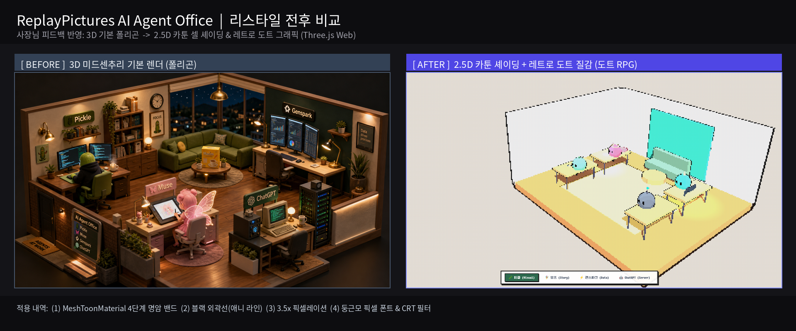

# ReplayPictures AI Agent Office 🏢

3D interactive miniature workspace for ReplayPictures AI Agents (Pickle, Muse, Genspark, ChatGPT).

- **Engine**: Built with Three.js & OrbitControls
- **2.5D Toon & Pixel Art**: Real-time cel-shading with `MeshToonMaterial`, dynamic black cartoon outline, and downscaled pixelation buffer (`image-rendering: pixelated`)
- **Interactive 360°**: Camera orbit, pan & zoom
- **Clickable Agents**: Workstations with retro 8-bit status cards & dialog bubbles (Pickle, Muse, Genspark, ChatGPT)
- **Retro Controls**: Real-time pixel size toggle (`2x` / `3.5x` / `5x`), CRT scanline filter toggle, and Light/Dark mode
